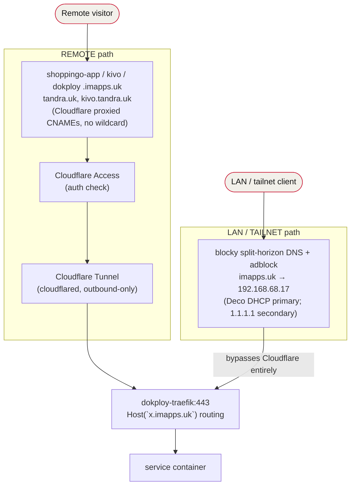

# Homelab — imapps.uk (Dokploy)

Agent-oriented map of how the Dokploy homelab fits together: topology, deploy flow, MCP control planes, service inventory, storage, DNS, and the Cloudflare Access model. Read this first before touching anything here.

> Companion docs: [`taisei-karate.md`](./taisei-karate.md) (separate AWS stack, not part of this homelab), `../SECURITY-AUDIT.md` (open findings), `../README.md` (blocky quickstart).

> Diagrams (open in excalidraw.com or the VS Code Excalidraw extension): [ingress & DNS](./diagrams/ingress-dns.excalidraw), [service inventory](./diagrams/service-inventory.excalidraw), [data & storage](./diagrams/data-storage.excalidraw), [deploy pipeline](./diagrams/deploy-pipeline.excalidraw), [ops automation](./diagrams/ops-automation.excalidraw), [monitoring stack](../monitoring/monitoring.excalidraw).

---

## 1. Physical / network topology

| Plane | Address | Notes |
|---|---|---|
| Dokploy host (`foundry`) LAN | `192.168.68.17` | single node, runs everything |
| Dokploy host WAN | `92.40.218.136` | no inbound port-forwards (the Cloudflare tunnel is outbound-only) |
| Dokploy host tailnet | `100.79.92.93` | tailscale, MagicDNS name `foundry` |
| `192.168.68.13` | — | Responds to ICMP only, no open service ports; **not** an active dependency — see §7. Stale from before the 2026-08-20 bare-metal migration. |
| LAN gateway | `192.168.68.1` | |

Single Docker host, swarm mode active with one node. Dokploy runs its `apps`/`sentinel` applications (and itself, `cloudflared`) as swarm services, so their containers are named `<appName>.1.<taskId>` and are addressed on `dokploy-network` by the service name (`shoppingo-api-zlusv1`). Everything else is a plain Docker Compose stack managed by Dokploy.

**Live health:** run `homelab-status` (dotfiles `bin/`) before trusting anything here; `--coverage` lists running services with no Gatus check or no row in §5.

> Host was reinstalled bare-metal on 2026-08-20 (previously Proxmox), which changed LAN/tailnet IPs from `.18`/`100.85.189.60` to the values above — confirmed against the live `mongodb`/`blocky` compose files and the `blocky` fix-hardcoded-IPs deployment, not from a prior copy of this doc. If you find another IP reference anywhere (scripts, other notes), it's stale — this file and the live compose files are the source of truth.

## 2. Ingress & DNS (how a request reaches a service)

Diagram: [`diagrams/ingress-dns.excalidraw`](./diagrams/ingress-dns.excalidraw).



- **One Cloudflare tunnel** `0da10189-66a3-49f1-b138-f1f617592567` → `dokploy-traefik:443` → Traefik hostname routing.
- **Public DNS is per-app, no wildcard (since 2026-10-18).** The zone has exactly three proxied CNAMEs to `0da10189-66a3-49f1-b138-f1f617592567.cfargotunnel.com`: `shoppingo-app`, `kivo`, `dokploy` (kept for the CI deploy webhooks). The `*.imapps.uk` CNAME was deleted; every other hostname has no public record and is reachable only on LAN/tailnet via blocky. To publish another app, add a proxied CNAME for it (and an Access bypass app if it should be anonymous). Certs are unaffected: Traefik's ACME records (`_acme-challenge.*` TXT) don't need a public A/CNAME. **Proxied names must be one level deep** (`x.imapps.uk`): the free Universal SSL cert covers only `imapps.uk` + `*.imapps.uk`, so `a.b.imapps.uk` fails the TLS handshake at the Cloudflare edge (why the app is `shoppingo-app`, not `app.shoppingo`).
- **`tandra.uk` and `www.tandra.uk` are not on foundry (since 2026-10-21).** They are the Tandra landing site on AWS S3 + CloudFront, DNS-only CNAMEs to the distribution managed by Terraform in the `shoppingo-site` repo. The app lives at `app.tandra.uk`; the site's CloudFront function redirects the old app paths (the app lived on the `tandra.uk` apex 2026-10-20/21) and returning users (`tandra_app` cookie, set on `tandra.uk` by the app) there. `shoppingo.imapps.uk`, the site's previous host, no longer has a public record.
- **`tandra.uk` zone (2026-10-20):** second Cloudflare zone, same account, zone id `8390d3abeee6eb8017bffba2aee34a71`. Two proxied CNAMEs to the same tunnel: `app.tandra.uk` (the Tandra app, `shoppingo-web` / `shoppingo-api`; it was on the apex until 2026-10-21) and `kivo.tandra.uk` (a second Dokploy domain on `kivo`). The apex and `www` are the landing site (above). kivo needs a host on the app's site because its refresh cookie is `SameSite=Strict`; from `app.tandra.uk` to `kivo.imapps.uk` the cookie would never be sent. The tunnel ingress names both hosts explicitly (the wildcard only covers `*.imapps.uk`). The zone has **no Access apps** (no default-deny), and blocky does **not** map it: LAN clients resolve it publicly and go through the tunnel, because Traefik has no Let's Encrypt cert for these names yet (a LAN client would get `TRAEFIK DEFAULT CERT`). Traefik's `CF_DNS_API_TOKEN` (set through Dokploy `settings.writeTraefikEnv`) is the account token `traefik-acme-dns` (vault `creds.cloudflare-traefik-dns`, since 2026-10-21): Zone Read + DNS Write on `imapps.uk` and `tandra.uk` only, no expiry, and it can create `_acme-challenge` TXT records on both zones. It is an account-owned `cfat_` token, so check it with `GET /accounts/<acct>/tokens/verify`; `/user/tokens/verify` rejects it. The broad admin token (`creds.cloudflare`) stays in the vault only. `shoppingo-app.imapps.uk` stays published only so old links and installs reach `shoppingo-web`'s nginx, which 301s them to `app.tandra.uk` and serves a service worker that retires the old install.
- **blocky** (`infra/blocky`) does split-horizon DNS: `imapps.uk → 192.168.68.17` (the host's reserved LAN IP). On LAN/tailnet, traffic goes straight to Traefik and **bypasses Cloudflare + Access**. → **CF Access only protects REMOTE traffic. Zero protection on LAN/tailnet.**
- Since 2026-09-22 the **Deco hands out `192.168.68.17` as DHCP primary DNS** (secondary `1.1.1.1`), so this applies to *every* device on the WiFi, not just tailnet clients. blocky also runs StevenBlack adware+malware blocklists for the whole LAN.
- **Except it wasn't reaching `foundry`.** On 2026-09-27 the host's own DHCP lease still carried the ISP resolvers `188.31.250.128/129`, not `192.168.68.17` — so the box running blocky was the one device not using it. The host is now pinned in netplan (§4a); the Deco setting was left alone, so **assume other long-lease devices may be in the same state** and spot-check one before trusting LAN-wide adblock numbers.
- **Secondary-DNS caveat:** during a blocky restart a client can fall through to `1.1.1.1`. For shoppingo-app/kivo/dokploy it gets the Cloudflare-proxied answer (dokploy then shows an Access prompt); every other `*.imapps.uk` name returns no answer until blocky is back and the negative cache expires. Accepted trade-off vs. losing all internet when blocky is down.
- Traefik entrypoints: `web` (80, redirect→https), `websecure` (443, letsencrypt certresolver). Services attach via `dokploy-network` + traefik labels.
- **Tailnet path** (not in the diagram): the `tailscale` stack advertises `192.168.68.0/24` as a subnet route, so tailnet devices reach the LAN (and blocky/Traefik on `192.168.68.17`) from anywhere. `gtnh` and `jott` are tailnet-only and never touch Traefik or Cloudflare (§5).
- Internal service-to-service DB access goes container-to-container over
  `dokploy-network`: `mongodb:27017`, `rustfs:9000`. It deliberately does not
  use `*.imapps.uk` names — those resolve via blocky to the host LAN IP, so a
  DHCP lease change would break every app (it did, 2026-09-19). Any service
  needing mongo or S3 must join `dokploy-network`.

## 3. Deploy flow (CRITICAL — read before any change)

Diagram: [`diagrams/deploy-pipeline.excalidraw`](./diagrams/deploy-pipeline.excalidraw).

IaC repo: `/home/home/imapps/foundry` on this host (path may differ on other machines) → `git@github.com:igor-siergiej/foundry.git`.

- **Dokploy deploys from GitHub HEAD, not local files.** Compose changes must be **commit + push** first.
- `autoDeploy=true` but the **webhook is unreliable — do NOT trust it to fire.** After push, deploy explicitly via `compose-deploy` (dokploy-mcp).
- **`git push` needs `dangerouslyDisableSandbox: true`** (sandbox has no network egress; DNS to github.com is flaky — retry fetch).
- App code images (shoppingo, jewellery-catalogue, kivo, sentinel, mixtape) are built + pushed by each app's own repo CI to Docker Hub `igurusama/imapps:<tag>`, then Dokploy pulls. `pull_policy: always` on `:latest` tags forces re-pull.
- **App deploy trigger:** app repo CI builds images with `utils/pipelines/scripts/publish-images.sh` (via the `.github/workflows-utils` submodule), `linux/amd64`, pushes to `igurusama/imapps`, then `curl`s the Dokploy app webhooks through a Cloudflare Access service token: `DEPLOY_WEB_URL` + `DEPLOY_API_URL` (shoppingo, jewellery-catalogue, sentinel), `DEPLOY_API_URL` only (kivo). mixtape is a single compose service hit via `DEPLOY_URL` with `X-GitHub-Event: push` (without it Dokploy ignores `ref` → "Branch Not Match"; `mixtape/.github/workflows/ci-cd.yml`).

### 3.5. Public surface — what is reachable from the internet

**Public DNS is the gate, not the tunnel ingress.** The tunnel's ingress is still a wildcard
(`*.imapps.uk` → `https://dokploy-traefik:443`, else `http_status:404`; read via the
cloudflare-api MCP, `GET /accounts/<acct>/cfd_tunnel/0da10189-…/configurations`, 2026-10-18), but
Cloudflare's edge only forwards a hostname into the tunnel when the zone has a **proxied CNAME** for it
pointing at `0da10189-66a3-49f1-b138-f1f617592567.cfargotunnel.com`. Without one, nothing reaches
foundry, even if a client `--resolve`s the name to a Cloudflare IP. Checked 2026-10-18 with
`curl --resolve <host>:443:104.21.45.248`:

- Access-bypass hosts with no record (`immich`, `gatus`) → `530`, Cloudflare `error code: 1016`
  (origin DNS error): the edge has no route to the tunnel.
- Hosts under the wildcard owner-email Access app with no record (`grafana`, `vault`, `analytics`,
  even a made-up `nonexistent-xyz`) → `302` to `imapps.cloudflareaccess.com`. That is Access answering
  at the edge before origin lookup, not the tunnel; past Access they'd hit the same 1016
  [inferred from the bypass hosts, not tested with an Access session].

Public hostnames (the whole list; §2 has the history):

| Hostname | Service | Access |
|---|---|---|
| `app.tandra.uk` | `shoppingo-web` / `shoppingo-api` (the Tandra app) | none (zone has no Access apps) |
| `tandra.uk`, `www.` | not foundry: Tandra landing site on AWS CloudFront (`shoppingo-site`) | none (DNS-only, never enters the tunnel) |
| `kivo.tandra.uk` | `kivo` (auth host for the app on `tandra.uk`) | none |
| `shoppingo-app.imapps.uk` | `shoppingo-web` (301 to `app.tandra.uk` only) | bypass |
| `kivo.imapps.uk` | `kivo` | bypass |
| `dokploy.imapps.uk` | Dokploy (CI deploy webhooks, admin) | own require-email app |

Everything else in §5, including `analytics.imapps.uk` (umami, jott #72), is LAN/tailnet-only: blocky
answers `192.168.68.17` and the tailnet reaches it via the foundry subnet route. jott has no hostname
at all (`100.79.92.93:8787`).

**Publishing a new service:** add one proxied CNAME `<app>.imapps.uk` →
`0da10189-66a3-49f1-b138-f1f617592567.cfargotunnel.com` (cloudflare-api MCP, zone
`e8069a9a6e586db3add05a408bd1e2d0`), plus an Access bypass app if it should be anonymous. No tunnel
change needed while the ingress is a wildcard. On `tandra.uk` the tunnel ingress also needs an explicit
hostname rule (before the `http_status:404` fallback), and there is no default-deny Access app, so the
host is public as soon as the CNAME exists. **Tailnet/LAN-only service:** add nothing in
Cloudflare.

## 4. MCP control planes (how an agent operates this homelab)

Two reachability tiers — don't assume a server is a native deferred tool just because it's configured somewhere:

| MCP | Reachability | Scope / capability | Gaps |
|---|---|---|---|
| **dokploy-mcp** | `mcp-cli --config ~/.mcp_servers.json call-tool dokploy-mcp:<tool>` | full Dokploy API: projects, compose/app CRUD + deploy, docker, domains, backups, env, users | API key lacks `sso-listProviders` + `auditLog-all` (both 403) |
| **cloudflare-api** | `mcp-cli --config ~/.mcp_servers.json call-tool cloudflare-api:<tool>` | remote MCP `https://mcp.cloudflare.com/mcp`. Account `ddf9791b93ad2e4cc5ef56aedfd7bd72`, zone `imapps.uk` = `e8069a9a6e586db3add05a408bd1e2d0`. Has **Access:Edit** | **lacks Zone WAF/Rulesets** — rate-limit rules need a scoped API token via `curl` |
| **grafana** | `mcp-cli --config ~/.mcp_servers.json call-tool grafana:<tool>` | dashboards/alerts at `grafana.imapps.uk` | — |
| **tailscale** | `mcp-cli --config ~/.mcp_servers.json call-tool tailscale:<tool>` | tailnet admin (OAuth client, write risk allowed) | — |
| **trello** | `mcp-cli --config ~/.mcp_servers.json call-tool trello:<tool>` | board `6a8ace741220b3624276fdf6` | — |
| **playwright** | native deferred tool (`mcp__plugin_playwright_playwright__*`) — ALSO in `~/.mcp_servers.json` for `mcp-cli` use outside Claude Code | browser automation | — |
| **github** | native deferred tool, plugin-managed (`plugin:github:github`, `api.githubcopilot.com`) | repo/PR/issue ops | needs `GITHUB_PERSONAL_ACCESS_TOKEN` in env at Claude Code launch (via `bw-run "github.pat" -- claude`) or it fails to connect |

Notes:
- **None of dokploy/cloudflare/grafana/tailscale/trello are native Claude Code deferred tools** — they're `mcp-cli`-CLI-only, by design (see user CLAUDE.md: avoids deferred-tool context bloat). Only Gmail/Drive/Calendar/Figma/GitHub/Playwright are registered natively (check with `claude mcp list`).
- `~/.mcp_servers.json` is vault-rendered (see dotfiles `docs/secrets.md`), not hand-edited — the checked-in shape lives at dotfiles `docs/mcp_servers.json.template`.
- **`~` is not `/home/home` inside a Paperclip agent run.** Paperclip sandboxes `HOME` to a per-run temp dir, so every `~/.mcp_servers.json` above resolves to a nonexistent file and *all* of these MCPs look unreachable. Use the absolute path — `mcp-cli --config /home/home/.mcp_servers.json call-tool dokploy-mcp:<tool>`. Verified working 2026-09-27.
- **MagicDNS on `foundry` — broken until 2026-09-27, now fixed.** See §4a. If `*.ts.net` stops resolving here again, that's the thing to check: the Paperclip control-plane MCPs (`home.tail2d4575.ts.net:8444`) fail at session start with `ENOTFOUND` and the fallback is `curl --resolve <host>:<port>:100.79.92.93`.
- **`cloudflare-api` needs a one-time OAuth sign-in per machine.** Its config entry is an `npx mcp-remote` stdio wrapper (`mcp-cli` only speaks stdio). Signed in on `home` 2026-10-18 (token in `/home/home/.mcp-auth/mcp-remote-v1/*_tokens.json`); see §4b to redo it. Tools are `search` (OpenAPI spec), `execute` (JS calling `cloudflare.request()`), `docs`, `whoami`.
- **Don't assume which machine you're on.** A SessionStart hook (`~/.claude/hooks/machine-context.sh`, dotfiles-managed) injects machine identity (hostname/tailscale IP → known role, e.g. this box IS `foundry` itself with direct docker access) at session start — read that context instead of assuming "laptop, reach host via tailscale". If the hook reports "unrecognized machine", check `hostname`/`tailscale status` yourself before trusting anything below that assumes a specific box.

## 4a. Host DNS resolution on `foundry` (fixed 2026-09-27)

**What was wrong.** `tailscaled` runs as a *host-network Docker container* (`infra-tailscale`,
`TS_USERSPACE=false`). Host networking means `tailscale0` and the `100.100.100.100` stub resolver
land in the host netns — so routing worked and `dig @100.100.100.100` always answered — but the
container keeps its own **mount** namespace, so every `/etc/resolv.conf` tailscaled wrote went into
the container and the host never saw it. `tailscale set --accept-dns=true` cannot fix that.
Separately, DHCP was handing this box the ISP resolvers `188.31.250.128/129` rather than blocky,
despite the Deco being configured to advertise `192.168.68.17`. Net effect: no `*.ts.net`, no
split-horizon `*.imapps.uk`, no adblock, on the host itself.

**How it's fixed, in two halves:**

1. **blocky forwards `ts.net`** — `blocky/config.yml` has `conditional.mapping.ts.net:
   100.100.100.100`. Bridge containers can reach the stub through the host's `100.64.0.0/10` route,
   so this works from inside blocky. This gives MagicDNS to *every* LAN client, not just the host.
2. **The host is pinned to blocky** — `/etc/netplan/00-installer-config.yaml` now sets
   `dhcp4-overrides.use-dns: false` plus `nameservers.addresses: [192.168.68.17, 1.1.1.1]` and
   `search: [tail2d4575.ts.net]`. Previous file backed up alongside as `.bak-2026-09-27`.
   Applied with `netplan generate && networkctl reload` (no link bounce).

**Ordering hazard:** the host's primary resolver is now a container on the host. `1.1.1.1` is the
secondary, so a blocky restart degrades rather than breaks DNS — but it means *never* leave blocky
down while doing anything that needs name resolution to bring it back. `blocky` is `restart: always`
for this reason.

**Note `/etc/resolv.conf` is in `uplink` mode, not `stub`.** blocky binds `0.0.0.0:53`, which
collides with systemd-resolved's `127.0.0.53:53` stub listener, so the stub is disabled. That means
per-domain split DNS via `resolvectl domain <link> ~domain` has **no effect** — resolv.conf points
clients straight at the link's uplink servers. Route domains through blocky's config instead.

Verify all three paths in one go:

```sh
getent hosts home.tail2d4575.ts.net   # 100.79.92.93   - MagicDNS
getent hosts dokploy.imapps.uk        # 192.168.68.17  - split horizon
getent hosts github.com               # public         - upstream
```

## 4b. Signing `cloudflare-api` in (one-time, needs a human browser)

`mcp-remote` derives a **fixed** callback port from the server URL: `28491`. It binds
`127.0.0.1:28491` on whichever box runs it, and stores the resulting token in `~/.mcp-auth`, so the
sign-in survives across sessions and only has to happen once per machine.

From a machine with a browser, tunnel that port to `foundry` and run the flow there:

```sh
ssh -L 28491:localhost:28491 home@foundry
# in that session:
MCP_REMOTE_CONFIG_DIR=/home/home/.mcp-auth \
  npx -y mcp-remote@latest https://mcp.cloudflare.com/mcp --transport http-only
# paste the printed https://mcp.cloudflare.com/authorize?... URL into your local browser
```

Agents then use it normally, but **must** pin the auth dir, because Paperclip sandboxes `HOME`:

```sh
MCP_REMOTE_CONFIG_DIR=/home/home/.mcp-auth \
  mcp-cli --config /home/home/.mcp_servers.json call-tool cloudflare-api:<tool> --args '{}'
```

If the token is missing or expired the call doesn't error — it **hangs** on
`Authentication required. Waiting for authorization...`. Always run it under `timeout`.

## 5. Projects & services (Dokploy inventory)

Org `QhuDFk1KJXDHR2xy0nwcK`. 5 projects (`apps`, `nas`, `infra`, `gtnh`, `sentinel`), all in `production` environment.

Diagram: [`diagrams/service-inventory.excalidraw`](./diagrams/service-inventory.excalidraw).

Each infra/gtnh stack with a README links it in the Notes column. Dokploy also attaches containers that have a Dokploy domain to `dokploy-network` even when the compose file does not declare it (observed live via `docker inspect` 2026-10-17: immich, jellyfin, navidrome, audiobookshelf, homeassistant, vaultwarden, mixtape-web) — that is how Traefik and Gatus reach them by container name.

### `apps`
| Service | Type | Host | Notes |
|---|---|---|---|
| shoppingo-web / shoppingo-api | app | app.tandra.uk (`shoppingo-app.imapps.uk` 301s there from the web nginx) | api uses fal.ai (`FAL_KEY`) + mongo + rustfs (`rustfs:9000`, own IAM user), optional opensearch. The `tandra.uk` apex is the landing site on AWS (`shoppingo-site`) |
| jewellery-catalogue-web / -api | app | jewellery-catalogue.imapps.uk | mongo + rustfs (`rustfs:9000`, own IAM user) |
| kivo | app | kivo.imapps.uk, kivo.tandra.uk | mongo; own JWT auth. `kivo.tandra.uk` exists so Shoppingo on `tandra.uk` gets its `SameSite=Strict` refresh cookie (same site) |
| jott | compose (`server/compose.yaml` in `igor-siergiej/jott`, built from source) | tailnet only: `100.79.92.93:8787` (host-published on the tailnet IP) | sync server; named volume `jott-data` on host disk; **no Gatus check**, not backed up |

### `nas` (compose stacks, media)
| Stack | Image | Container port | Ingress |
|---|---|---|---|
| immich | `immich-server:v3.2.0` (+ ml, redis, pg16) | 2283 | immich.imapps.uk — **Access bypass**, own login. See [`../immich/README.md`](../immich/README.md) |
| jellyfin | `jellyfin:10.11.11` | 8096 | jellyfin.imapps.uk — bypass. See [`../jellyfin/README.md`](../jellyfin/README.md) |
| navidrome | `navidrome:latest` | 4533 | navidrome.imapps.uk — bypass. See [`../navidrome/README.md`](../navidrome/README.md) |
| audiobookshelf | `audiobookshelf:latest` | 80 (Dokploy domain port; Gatus checks `:80`) | audiobookshelf.imapps.uk — bypass. See [`../audiobookshelf/README.md`](../audiobookshelf/README.md) |
| mixtape | `igurusama/imapps:mixtape-{api,web}-latest` | web 3000, api 3001 | mixtape.imapps.uk — bypass; YouTube→mp3 into the Navidrome music dir and mp4 into the Jellyfin media dir (both ZFS binds, read-write). See [`../mixtape/README.md`](../mixtape/README.md) |
| resilio-sync | `resilio/sync:latest` (runs as uid 1000) | 8888 (GUI), 55555 tcp+udp — published on the **tailnet IP only** | syncs the notes dir `/mnt/tank/shared/notes` across devices. See [`../resilio-sync/README.md`](../resilio-sync/README.md) |

None of these publish a host port (`ports:` block) — confirmed against the live compose files — except resilio-sync, which publishes on the tailnet IP only. "Container port" is what Traefik routes to internally via `dokploy-network`; the `nas` compose files do not declare that network — Dokploy attaches it at deploy for services with a domain (observed live). Nothing here is reachable by hitting the host LAN IP directly on that port. (This was tightened in the 2026-07-04 hardening pass — see git log on this repo for `harden: remove 0.0.0.0 host ports` if you need the before/after.)

### `infra`
| Stack | Image | Ports | Notes |
|---|---|---|---|
| cloudflared | (app) | — | the tunnel |
| tailscale | `tailscale:latest` | host net | `network_mode: host`, hostname `foundry`, advertises route `192.168.68.0/24`. See [`../tailscale/README.md`](../tailscale/README.md) |
| blocky | `spx01/blocky:latest` | 53 (host-published, LAN DNS) | split-horizon DNS; web UI/metrics now internal-only via `dokploy-network` (`:4000` host publish dropped in the 2026-07-04 hardening pass). See [`../blocky/README.md`](../blocky/README.md) |
| mongodb | `mongo:7.0` | 27017, **no host publish, no Traefik route** (internal-only on `dokploy-network`) | shared DB (kivo, shoppingo, jewellery, mixtape). ZFS bind mount. Admin: `docker exec -it mongodb mongosh`, or the socat tunnel in [`../mongodb/README.md`](../mongodb/README.md#remote-access) |
| rustfs | `rustfs/rustfs:1.0.3@sha256:9ca955…` | 9000 S3 / 9001 console, **no host publish**; Traefik `rustfs-console.imapps.uk` → 9001 (LAN/tailnet, no public DNS) | S3 for shoppingo, jewellery-catalogue and minio-gallery (`rustfs:9000`), one IAM user per consumer. ZFS dataset `tank/shared/rustfs`. See [`../rustfs/README.md`](../rustfs/README.md) |
| monitoring | loki/promtail/prometheus/cadvisor/node-exporter/grafana/gatus + docker-socket-proxy | none host-published; Traefik: grafana → 3000, gatus → 8080 | grafana.imapps.uk, gatus.imapps.uk. docker-socket-proxy (`CONTAINERS=1`, `NETWORKS=1`) fronts promtail's Docker API access (`../SECURITY-AUDIT.md` #10, closed). See [`../monitoring/README.md`](../monitoring/README.md) |
| home-assistant | `home-assistant:2024.12.3` | 8123; Traefik `home-assistant.imapps.uk` | unprivileged container (no host devices; `privileged` + NET_ADMIN/NET_RAW dropped 2026-10-10) on its own bridge + Dokploy-attached `dokploy-network` (no host network, so no LAN discovery). See [`../homeassistant/README.md`](../homeassistant/README.md) |
| vaultwarden | `vaultwarden/server:1.37.2` | vault.imapps.uk | self-hosted secrets/password vault, replaces plaintext `~/notes/secrets/tokens.md`; ZFS bind mount (`/mnt/tank/shared/vaultwarden`); see [`README.md`](./README.md#secrets) and [`../vaultwarden/README.md`](../vaultwarden/README.md) |
| opensearch | `opensearch:2.19.1` | 9200, internal-only on `dokploy-network`, no Traefik route | shoppingo recipe-discovery index; derived from mongo, not backed up; security plugin off. See [`../opensearch/README.md`](../opensearch/README.md) |
| minio-gallery | `machines/filestash@sha256:edb76c…` | 8334; Traefik `minio-gallery.imapps.uk` on the **`web` (HTTP) entrypoint only** | Filestash S3 browser; sign in to the S3 backend with endpoint `http://rustfs:9000` and `creds.rustfs-filestash`; own admin login. HTTP-only router, see `../SECURITY-AUDIT.md` #11. See [`../minio-gallery/README.md`](../minio-gallery/README.md) |
| umami | `umami-software/umami@sha256:6cd9d…` + `postgres:16-alpine@sha256:1a66d7…` | Tailscale/LAN-only: no public DNS record, so the Cloudflare edge never routes it into the tunnel (§3.5); tailnet split-DNS routes `*.imapps.uk` → blocky on 192.168.68.17, which the foundry subnet route carries over Tailscale | shoppingo self-hosted analytics (tracker config in `packages/web/analytics.ts`); one Umami instance backs all consumers (jewellery-catalogue next). See [`../umami/README.md`](../umami/README.md) (added by #72). Keep it out of Cloudflare DNS. |

### `gtnh` (game server)
| Service | Image | Ingress | Notes |
|---|---|---|---|
| gtnh | `itzg/minecraft-server:java21` (`TYPE: GTNH`) | tailnet only: `gtnh.tail2d4575.ts.net:25565` | GregTech New Horizons. `network_mode: service:gtnh-tailscale` — no `dokploy-network`, no Traefik. Whitelisted. Only `gtnh/docker-compose.yml` is tracked; the other files in `gtnh/` are local server leftovers (gitignored). See [`../gtnh/README.md`](../gtnh/README.md) |
| gtnh-tailscale | `tailscale/tailscale:latest` | own tailnet node `gtnh` | `TS_AUTHKEY_GTNH`; see `../SECURITY-AUDIT.md` #1 (tailnet ACL) |

### Not Dokploy-managed (local dev)
`dev-mongodb`, `dev-rustfs`, `dev-navidrome` are local development containers bound to `127.0.0.1` only (from `~/imapps/utils/docker`). Not production, not monitored; safe to ignore in health checks.

### `sentinel`
| Service | Host | Notes |
|---|---|---|
| web / api | sentinel.imapps.uk | own require-email Access app; api holds HA long-lived token; fetches Gatus status JSON via `/api/gatus/statuses` (since sentinel PR #8) — the only iframes are Grafana public dashboards. The `gatus-iframe` frame-ancestors middleware in `../monitoring/docker-compose.yml` is likely vestigial |

## 6. Cloudflare Access model (set 2026, default-deny)

- Only `shoppingo-app`, `kivo` and `dokploy` have public DNS in `imapps.uk` (§2), so the Access apps below only matter for those three; the rest are dormant config for hosts that no longer resolve remotely. The `tandra.uk` zone (`tandra.uk`, `kivo.tandra.uk`) has no Access apps at all.
- **Wildcard `*.imapps.uk`** app = require owner email (`igorsiergiej@gmail.com` + `gregormai@mail.de`). Catches everything not explicitly bypassed.
- **Explicit Bypass** apps (public / own-auth): immich, shoppingo, jewellery-catalogue, kivo, mixtape, audiobookshelf, jellyfin, navidrome, gatus.
- **dokploy** + **sentinel** keep their own require-email apps.
- immich has a rate-limit rule on `/auth/login` (15 req / 10s / IP → block).
- Reminder: Access is a **remote-only** gate (see §2). On LAN and tailnet, own-auth is the only protection.
- **Widened 2026-09-22:** the Deco now points all DHCP clients at blocky, so *every device on the WiFi* — including guests and IoT — takes the LAN path and bypasses Access. Previously this was limited to tailnet devices. Anything whose only gate is the wildcard Access app (grafana, home-assistant) is now protected on-LAN solely by its own login.

## 7. Storage

Diagram: [`diagrams/data-storage.excalidraw`](./diagrams/data-storage.excalidraw).

- Most volumes are **local ZFS** (`zpool tank`, mirrored, bind-mounted from `/mnt/tank/shared/*`): immich uploads, mongodb data, rustfs data, vaultwarden, home-assistant config, loki/prometheus/grafana/gatus, navidrome music (shared read-write by mixtape, read-only by navidrome), jellyfin media (shared read-write by mixtape at `/videos`). All compose `driver_opts` are `type: none` (bind), not `nfs` — confirmed against every live compose file.
- `192.168.68.13` is **not** the storage backend — that claim was stale, left over from before the 2026-08-20 bare-metal migration. The device still answers ICMP intermittently but has no open ports and nothing in this repo mounts from it. Gatus's "NFS Server" check against it was removed 2026-09-28 for exactly this reason.
- **Host-disk (Docker root on the LVM root FS, not `tank`) named volumes:** `immich-pgdata` (covered by the nightly `pg_dumpall`, §9), `gtnh-data` (covered by the nightly world tar, §9); not backed up: `jott-data`, `jellyfin-config`/`jellyfin-cache`, `audiobookshelf-config`, `filestash-state`, `resilio-config2`, the two tailscale state volumes and `promtail-positions`. audiobookshelf's `/metadata` has no mount at all (container writable layer — lost on recreate). Host disk loss loses the live data; see `../SECURITY-AUDIT.md` #5.

## 8. Nightly prod smoke routine

A `systemd` timer (`smoke/systemd/foundry-smoke.timer`) runs nightly at
**03:15** and invokes `smoke/bin/run-smoke.sh`. The script shells out to
`kanban-cli e2e live <repo> --url <prod>` for each of shoppingo,
jewellery-catalogue, kivo and mixtape — which by default runs only that
repo's `@smoke`-tagged Playwright tests against production. Gatus is the
fast "is it up at all" layer; this is the nightly "does the actual flow
still work" layer (the failures Gatus can't see: images 404/401, the
shoppingo fal key stale, a redirect misconfigured, etc.). mixtape currently
has no `@smoke`-tagged tests, so its run executes nothing. Diagram:
[`diagrams/ops-automation.excalidraw`](./diagrams/ops-automation.excalidraw).

- One **Discord alert per run** (not per app) summarises every failing
  app with: failing test names, a 40-line container log tail from the
  matching app container, and the last 3 Dokploy deploys for that app.
- Green runs stay silent — exit 0, no message.
- Each app needs a dedicated test account whose creds live in Vaultwarden
  (`smoke.<app>.account` items, fed via `bw-run` at test time). The
  routine **does not** create these; create them by hand following
  `docs/secrets.md`.
- Env file `/etc/foundry/smoke.env` (mode 600, root) holds the Discord
  webhook URL. Rendered once by hand; the systemd unit reads it via
  `EnvironmentFile=`. No `BW_SESSION` exported from the service.
- Deploy instructions and full failure-mode notes: `../smoke/README.md`.

## 9. Backups & restore drill

The `backups/` directory ships a nightly backup suite + a weekly restore
drill. Both run as systemd timers on the foundry host and post to the
same Discord webhook as Gatus / smoke routine. Diagrams:
[`diagrams/data-storage.excalidraw`](./diagrams/data-storage.excalidraw),
[`diagrams/ops-automation.excalidraw`](./diagrams/ops-automation.excalidraw).

**Backup** (`backups/bin/backup.sh`, daily at **02:00**) — iterates
`backups/config/<service>.sh`, dumps each to
`/mnt/tank/shared/backups/<service>/<timestamp>/` (or `.tar.gz`),
prunes by `RETENTION_DAYS`, and exits non-zero on any failure.

| Service | Config | Strategy |
|---|---|---|
| mongodb | `backups/config/mongodb.sh` | `mongodump --gzip` via docker exec |
| immich Postgres | `backups/config/immich-pg.sh` | `pg_dumpall` via docker exec, gzipped |
| vaultwarden | `backups/config/vaultwarden.sh` | SQLite `.backup` + RSA key, tar'd |
| navidrome | `backups/config/navidrome.sh` | SQLite `.backup` of `navidrome.db` |
| homeassistant | `backups/config/homeassistant.sh` | tar of `/mnt/tank/shared/homeassistant/config` (excludes deps, recorder DB) |
| gtnh | `backups/config/gtnh.sh` | `rcon-cli save-all` then alpine sidecar tar |

Not yet backed up: rustfs (S3 mirror with a read-only IAM user, ~150 MB), opensearch (rebuild from
mongo), jellyfin / audiobookshelf / monitoring / mixtape / resilio-sync
(metadata-only SQLite, rebuild-from-scratch cheap). Tracked as a single
follow-up card.

**Restore drill** (`backups/bin/restore-drill.sh`, weekly **Sun 02:30**)
— for every config, restores the newest dump into a throwaway container
with `--network none` and a non-prod port, runs a sanity query (row
count + integrity check), and tears down. If a service can't be
restored, that means a backup is silently broken — exactly the kind of
failure a `cron + ls` backup loop won't notice.

**Stale check** (`backups/bin/stale-check.sh`, **hourly**) — alerts on
any service whose newest dump is older than 2× its schedule (so a weekly
service flags after 2 days; a nightly service flags after 2 days).

Env: `/etc/foundry/backup.env` (mode 600, root) holds the Discord
webhook URL and `MONGO_ROOT_USER`/`MONGO_ROOT_PASSWORD`. No
`BW_SESSION` is exported from any timer — the mongo creds live in
Dokploy env, not Vaultwarden; if that ever moves, follow the
`bw-render-template` pattern in `dotfiles/docs/secrets.md` from a
one-shot session.

What this is **not**: not off-host. `/mnt/tank/shared/backups` is the
same ZFS mirror as the source data. An off-host copy (rclone to
Backblaze B2 or a friend's box) is a separate follow-up.

## 10. Gotchas checklist (for future agents)

- [ ] Compose change → commit + push (`dangerouslyDisableSandbox:true`) → **explicit `compose-deploy`** (webhook unreliable).
- [ ] dokploy/cloudflare/grafana/tailscale/trello are `mcp-cli`-only, not deferred tools — see §4.
- [ ] Cloudflare MCP can't do WAF/rate-limit — use a scoped API token + `curl`, then revoke it.
- [ ] Check the SessionStart machine-identity context before assuming you're on the laptop or the host — this session may be running directly on `foundry` with direct docker access, or on a laptop needing tailscale to reach it. Don't guess; the hook output says which.
- [ ] Some public wifi has a middlebox that ACKs every SYN → false "port OPEN". Judge reachability by real protocol replies (HTTP body, mongo wire), not raw connect.
- [ ] Access protects remote only; LAN/tailnet bypasses it via blocky split-horizon.
- [ ] Split-horizon reaches **every LAN + tailnet device** since 2026-09-22 (Deco DHCP primary DNS = `192.168.68.17`, secondary `1.1.1.1`); tailnet MagicDNS resolver is `100.79.92.93` → same blocky. Before that date it was tailnet-only because the router handed out ISP resolvers (`188.31.250.128/129`). To check whether real LAN clients are using it, look for `192.168.68.x` addresses in `docker logs blocky` — all-`100.x` means the DHCP setting has not taken effect.
- [ ] blocky is now a **whole-house dependency**: it runs adblock (StevenBlack adware+malware) for every device. A false positive breaks that site for everyone — add an `allowlists` entry in `blocky/config.yml` rather than disabling blocking. `restart: always` + a `blocky healthcheck` healthcheck guard availability.
- [ ] `/etc/hosts` on `foundry` pins `vault/dokploy/grafana.imapps.uk → 192.168.68.17`. Any Access/WAF check run **from this host** silently takes the LAN path and looks unprotected. Test the real edge with `curl --resolve <host>:443:104.21.45.248` before declaring an Access gap (a false "Access is off" finding came from exactly this, 2026-09-20).
- [ ] Dokploy **rebuild/redeploy does not regenerate** `/etc/dokploy/traefik/dynamic/<appName>.yml`. `sentinel-api`'s file was missing, so `Host(sentinel.imapps.uk) && PathPrefix(/api)` had no router and every `/api` call fell through to the web SPA (HTML instead of JSON). Fix: `domain.update` on the app's domain rewrites the file immediately — no rebuild needed.
- [ ] Home Assistant's `.storage` registries were reset on 2026-08-20 (`core.config_entries`/`core.entity_registry`/`core.device_registry` all rewritten that evening): only `sun` + `go2rtc` remain, the TP-Link integration is gone, and the recorder DB has no history of the old entities. HA also runs on a **bridge** network, so Kasa/Tapo UDP broadcast discovery can never work — plugs must be added by IP (live KLAP devices: `192.168.68.9`, `.11`, `.14`), and they are cloud-bound so the TP-Link account credentials are required.
- [ ] **This doc drifted from reality once already** (stale `.18`/`100.85.189.60` host IPs from before the 2026-08-20 bare-metal migration, a stale "host port" claim for services hardened on 2026-07-04) — found and fixed 2026-08-23 by cross-checking the live compose files instead of trusting the doc. If something here looks surprising, check the actual compose file / `dokploy-mcp` state before trusting this doc over it.
- [ ] **Drifted again, found 2026-09-28:** doc claimed "most volumes are NFS on the NAS `192.168.68.13`" — false, every compose `driver_opts` is a local bind mount to `zpool tank`, and `.13` has no open ports. Also found: Gatus's bare-apex `https://imapps.uk` cert check always failed (Traefik has no router for the apex host, only `*.imapps.uk`, so it serves Traefik's default self-signed cert) and its object-storage check hit `host.docker.internal:9000`, a port the store didn't publish on. Fixed in the Gatus config (now `monitoring/config/gatus/config.yaml`): dropped the NFS + apex checks and moved storage checks to service names over `dokploy-network`.
- [ ] **Gatus config lives at `monitoring/config/gatus/config.yaml`, mounted as a directory** so Gatus hot-reloads it after a deploy. It used to be a single-file bind mount of `gatus-config.yml`, which never saw the file git replaced, so new checks silently didn't load until a manual restart (2026-10-14). `homelab-status` now flags a mismatch between deployed and live check counts. Dokploy apps are checked via their public hostname (`https://<app>.imapps.uk/...`), not the suffixed swarm service name; the exception is sentinel-api, whose `/health` isn't reachable through Traefik.
- [ ] **Monitoring deploys force a full container recreate.** Every `compose-deploy` of `monitoring` re-clones `/etc/dokploy/compose/infra-monitoring-xbyv0n/code` and runs `docker compose ... up -d --force-recreate` (the `--force-recreate` is in the Dokploy compose's `command` field, set via `dokploy-mcp compose.update`). Without that flag, a service whose spec didn't change keeps its bind mount to the deleted directory inode and runs on stale config — the original "dashboard JSON edited, but grafana doesn't see it until a manual `docker restart grafana`" report (2026-10-16). `--force-recreate` recreates every container on every deploy; the bind mount source is the freshly-cloned path, so the new container sees the new content. Gatus still hot-reloads its config in place once the recreated container comes up.
- [ ] **This homelab and `taisei-karate` (AWS) share no infrastructure** — different clouds, different auth models, different deploy pipelines. See [`taisei-karate.md`](./taisei-karate.md).
- [ ] **Nightly smoke tests reuse `kanban-cli e2e live`** — same scoped `@smoke` filter each repo declares in `.kanban-cli.json` `e2e.smokeGrep`. An app with no `.kanban-cli.json` is logged-and-skipped, not failed. Don't add `@smoke` tags speculatively; the smoke tier runs against production.
- [ ] **After every Dokploy upgrade, recheck `SECURITY-AUDIT.md` #3 + #9**: `docker service inspect dokploy --format '{{json .Endpoint.Spec.Ports}}'` must be `null`, and from a container on `dokploy-network` `wget -qO- http://dokploy-traefik:8080/api/overview` must 404. Both findings closed 2026-10-18 by `docker service update --publish-rm` (re-opens on upgrade) and the `settings.updateTraefikConfig` MCP call, respectively; the Dokploy upgrade to v0.30.8 re-added the publish and the audit had to be re-verified.

## 11. Kanban tools — work-board, jott, and the Collie buttons

Every project's work — shoppingo, kivo, foundry, etc — is tracked as a jott task (`jott task list --json` etc). Three skills drive the loop:

- **kanban-worker** — pulls a Backlog task per project, implements it, runs Playwright e2e as a merge gate, opens a PR, waits for CI, merges, waits for deploy, runs a live smoke check, and reverts+blocks if it fails. The work itself is autonomous; the gate decisions aren't.
- **refining-kanban-captures** — turns Inbox captures (raw phone-typed thoughts) into real Backlog items by reading the repo first. Never runs automatically; a human kicks it off.
- **triaging-blocked-cards** — walks every Blocked card, asks one decision per card with a recommendation, applies answers in jott.

All three are shipped with the dotfiles under `claude/.claude/skills/{kanban-worker,refining-kanban-captures,triaging-blocked-cards}/SKILL.md` and depend on `kanban-cli` (the deterministic repo-side plumbing — resolve-repo, pr, ci wait, deploy wait, ship, e2e). `kanban-cli` is the `@imapps/kanban-cli` npm package, installed at `home/.bun/install/global/node_modules/@imapps/kanban-cli`. Pinned version on this host: **3.0.0** (`jq -r .version /home/home/.bun/install/global/node_modules/@imapps/kanban-cli/package.json`); the dep entry at `home/.bun/install/global/package.json` is `"@imapps/kanban-cli": "^3"`, so a `bun install -g` upgrades within major v3 but does not jump majors. To refresh after a Dotploy-LAN node-rotation: re-run that bun install on each machine that drives a board.

The previous "type the prompt into a fresh pane" workflow has been replaced by one-tap phone buttons.

- **`foundry/bin/work-board.sh`** — the launcher target. Subcommands:
  - `work-board <project>` — resolves the project's checkout (`kanban-cli resolve-repo`) and runs `kanban-worker` against its Backlog.
  - `work-board all` — same, but iterates every project.
  - `work-board refine` — `refining-kanban-captures` over the global inbox.
  - `work-board triage` — `triaging-blocked-cards` across every project.
  - `work-board refresh` — re-runs `foundry/bin/regen-launchers.sh` (no Claude session; pure config regen).

  Permission mode is read from `KANBAN_WORKER_PERMISSION` at launch time:
  - `acceptEdits` (default) — file writes auto-approved, Bash prompts. Safe-by-default.
  - `bypass` — `--dangerously-skip-permissions`. Set explicitly on the machine; do NOT default to this.
  - `manual` / `plan` / `auto` / `dontAsk` — pass through to `claude --permission-mode`.

  Prompts are built with `printf '%s\n'` and passed via `claude -- "…"` so a `blocked_reason` with backticks, dollar signs or backslashes round-trips verbatim. Every project row resolves its own cwd (the project's checkout, not foundry); the meta-board rows (`all`/`refine`/`triage`/`refresh`) run from the foundry repo.

- **`foundry/bin/regen-launchers.sh`** — fully derives the Collie `launchers.toml` from `jott task projects --json` plus four fixed always-on rows (`All projects`, `Refine inbox`, `Triage blocked`, `Refresh boards`). Re-running is idempotent (`diff` is empty when the project list hasn't changed). On every regen it writes **two** copies: the canonical herdr.collie plugin config at `~/.config/herdr/plugins/config/herdr.collie/launchers.toml` (what herdr reads on reload), and a mirrored copy in the dotfiles repo at `~/dotfiles/herdr/.config/herdr/plugins/config/herdr.collie/launchers.toml` (so `make linux` → stow survives a re-install). The regen ends with `herdr server reload-config` so the buttons surface immediately.

- **Generated `launchers.toml`** — the file herdr ships to the phone. Now active at `~/.config/herdr/plugins/config/herdr.collie/launchers.toml`; the dotfiles mirror at `~/dotfiles/herdr/.config/herdr/plugins/config/herdr.collie/launchers.toml` keeps it across re-stows. Schema: each row is `command` (a shell line — we use `<foundry>/bin/work-board.sh <sub>`), `label` (the tap text), `cwd` (where the new Space opens). On a launch tap from the dashboard a NEW Space opens; from a pane's switcher a new TAB opens in that pane's own Space.

- **`commands.toml`** at `~/.config/herdr/plugins/config/herdr.collie/commands.toml` (also mirrored under the dotfiles path) registers `/work-board ` (with a trailing space — a tap puts `/work-board ` into the composer for the operator to finish) under `scope = "claude"`. The keyboard-step-away complement to the launchers; inside a Claude pane, type the sub after the space. Trade-off: per ADR 0018, scoping even one row to `claude` REPLACES the Claude Code shipped palette on claude panes rather than merging; the ~50 shipped shortcuts (`/compact`, `/model`, `/clear`, …) stay reachable through Claude's own `/` completion, but the keyboard-step-away surface loses them. To get them back on the tap surface, restate the wanted rows in your own `commands.toml`. omp / codex / pi / etc. panes keep their shipped catalogs untouched.

The "Collie New app Run button" (PWA action that opens a new app via the herdr socket API) is **out of scope** for the kanban-loop wiring here — jott's project list is the source of truth for buttons today, and a "Run new app" button is its own card.