# taisei-karate — AWS static site (Terraform)

Agent-oriented map of `taisei-karate`'s AWS deployment. **Not part of the Dokploy homelab** — different cloud, different auth model, own repo (`taisei-karate`, sibling to `foundry` under `imapps/`), own Terraform state. See [`homelab.md`](./homelab.md) for the Dokploy side.

Source of truth for this stack is the code: `taisei-karate/infra/*.tf` (Terraform) and `taisei-karate/.github/workflows/*.yml` (CI/CD). This doc is a map to orient in that code, not a replacement for it — when they disagree, the code wins; update this doc. Repo-side diagram: [`docs/diagrams/architecture.excalidraw`](https://github.com/igor-siergiej/taisei-karate/blob/main/docs/diagrams/architecture.excalidraw).

## 1. What it is

Astro static site, no servers. Built by GitHub Actions, uploaded to a private S3 bucket, served through CloudFront. Two small Lambdas handle the only dynamic bits: a contact-form mailer and a Keystatic (CMS) GitHub OAuth exchange (`keystatic.config.ts` uses `storage.kind: 'github'` — content lives in the repo, not Keystatic Cloud).

## 2. Architecture

```mermaid
flowchart TB
    visitor([Visitor]):::ext
    editor([Site editor<br/>/keystatic CMS]):::ext
    dev([Push to main]):::ext
    disp([Manual workflow_dispatch]):::ext

    subgraph aws["AWS (eu-west-2 + us-east-1 for CDN-scoped resources)"]
        waf["WAFv2 WebACL (optional, enable_waf=false default)<br/>rate-limit 2000/IP + AWS managed rule groups<br/>(us-east-1, CLOUDFRONT scope)"]
        mon["CloudWatch alarms + SNS email topics<br/>(eu-west-2 + us-east-1)<br/>only if enable_security_stack"]
        cf["CloudFront distribution<br/>OAC-signed · security headers · gzip<br/>403/404 → /404.html"]
        s3site[("S3 site bucket (private)<br/>versioned, 30d noncurrent expiry")]
        s3logs[("S3 logs bucket<br/>CloudTrail + CF + S3 access logs<br/>90d/365d expiry")]
        lambdaContact["Lambda: contact-form<br/>API Gateway HTTP API<br/>SES send"]
        lambdaAuth["Lambda: keystatic-auth<br/>Function URL, origin-verify header<br/>GitHub OAuth token exchange"]
        route53["Route 53 zone<br/>(only if domain_name set)"]
        acm["ACM cert (us-east-1)<br/>(only if domain_name set)"]
        ses["SES domain identity + DKIM<br/>(only if domain_name set)"]
        trail["CloudTrail<br/>multi-region, all mgmt events<br/>only if enable_security_stack"]
        oidc{{"IAM OIDC provider<br/>token.actions.githubusercontent.com"}}
        deployRole["IAM role: gha-deploy<br/>s3 sync + cf invalidation only"]
        tfRole["IAM role: gha-terraform<br/>broad CRUD, scoped to project-* names"]
    end

    subgraph gh["GitHub Actions"]
        cicd["ci-cd.yml<br/>lint → test → build → release<br/>push: deploy-staging · dispatch: deploy-prod"]
        content["content-deploy.yml<br/>build → deploy (src/content/** — Keystatic writes)<br/>push: deploy-staging · dispatch: deploy-prod"]
        tf["terraform.yml<br/>plan (PR, staging workspace, posts comment)<br/>push: apply-staging · dispatch: apply-prod (default workspace)"]
    end

    tfstate[("S3 backend bucket<br/>taiseikarate-tfstate-*<br/>native lockfile, no DynamoDB")]:::ext

    %% visitor request path
    visitor -->|HTTPS| cf
    waf -.->|"if enable_waf"| cf
    cf -.->|metrics| mon
    lambdaContact -->|send| ses
    cf -->|"OAC SigV4, SourceArn-scoped bucket policy"| s3site
    cf -.->|"/api/keystatic/* only"| lambdaAuth
    cf -->|access logs| s3logs
    lambdaContact -->|POST via API Gateway, CORS-scoped| visitor

    %% editor path
    editor -->|"OAuth via /keystatic"| lambdaAuth
    editor -->|"content read/write, post-login"| gh

    %% app deploy path
    dev --> cicd
    dev --> content
    dev --> tf
    disp --> cicd
    disp --> content
    disp --> tf
    cicd -->|"AssumeRoleWithWebIdentity, environment:staging|production"| oidc
    content -->|"AssumeRoleWithWebIdentity, environment:staging|production"| oidc
    oidc -.->|federates| deployRole
    cicd -->|"s3 sync + invalidate"| s3site
    content -->|"s3 sync + invalidate"| s3site

    %% infra deploy path
    tf -->|"AssumeRoleWithWebIdentity<br/>environment:staging|production"| oidc
    oidc -.->|federates| tfRole
    tf -->|provisions| aws
    tf -->|state read/write| tfstate

    classDef ext fill:#f2f0ea,stroke:#c8102e,color:#141414;
```

**Request path:** visitor → CloudFront (OAC-signed read from private S3). Bucket denies all public access; policy only allows `cloudfront.amazonaws.com` scoped to this distribution's ARN. `/api/keystatic/*` alone routes to the auth Lambda instead of S3. WAF is **off by default** (`var.enable_waf = false`, `waf.tf` resources are `count`-gated, ~$8/mo when on); the `monitoring.tf` alarms stand in for it — they notify, they don't block, so a sustained flood means flipping `enable_waf` true and applying.

**Environments:** every AWS-touching job sets a GitHub `environment:` (`staging` or `production`), and GitHub vars are per-environment (same names, different values; environment-then-repo fallback). Push to `main` deploys/applies **staging only**; production needs a manual `workflow_dispatch` (`build-prod`/`deploy-prod` in `ci-cd.yml` and `content-deploy.yml`, `apply-prod` in `terraform.yml`). Terraform maps workspace → environment: `staging` workspace (selected via `TF_WORKSPACE: staging` before `init`) = staging, `default` workspace = production.

**App deploy path (`ci-cd.yml` / `content-deploy.yml`):** push to `main` (staging) or dispatch (prod) → GitHub Actions builds → assumes `gha-deploy` via OIDC (**no stored AWS keys**) → `aws s3 sync` (3 passes: immutable hashed assets, short-cache images, no-cache everything else) → CloudFront invalidation. Content-only edits (Keystatic writes under `src/content/**`) skip lint/test/release and use the lighter `content-deploy.yml` path; everything else uses `ci-cd.yml`.

**Infra deploy path (`terraform.yml`):** PR touching `infra/**` → `terraform plan` against the `staging` workspace via `gha-terraform` (OIDC, `environment:staging` sub claim) → plan posted as a PR comment (no branch-protection gate — private repo, no GitHub Pro — treat red plan as "don't merge", not a hard block). Push to `main` (`infra/**`) → `apply-staging` (staging workspace). `workflow_dispatch` → `apply-prod` (default workspace, `environment:production`). Staging apply hard-codes `TF_VAR_domain_name: ""`/`TF_VAR_contact_from_address: ""` so it never inherits prod's domain via var fallback and tries to create a second zone/cert/SES identity.

## 3. Resource inventory

| Resource | File | Notes |
|---|---|---|
| S3 site bucket | `s3.tf` | private, versioned, OAC-only read, 30d noncurrent-version expiry |
| S3 logs bucket | `logging.tf` | CloudTrail + CF + S3 access logs; `BucketOwnerPreferred` (LogDelivery ACL group still required) |
| S3 tfstate bucket | `backend.tf` | `taiseikarate-tfstate-777799876926`, eu-west-2, native S3 lock (TF ≥ 1.11), **pre-exists, not managed by this config** |
| CloudFront distribution | `cloudfront.tf` | OAC to S3, response-headers policy (HSTS/CSP/etc.), `keystatic_index` viewer-request function (directory-index rewrite + `domain_hidden` gate + Host header recovery) |
| ACM cert | `acm.tf` | us-east-1 only (CloudFront requirement); **skipped entirely while `domain_name` unset** |
| Route 53 zone + records | `route53.tf` | apex/`www` A+AAAA aliases to CloudFront, SPF, DMARC (`p=none`); **skipped while `domain_name` unset** |
| WAFv2 WebACL | `waf.tf` | **only if `enable_waf`** (default `false`); us-east-1 (CLOUDFRONT scope); rate-limit (2000/IP) + AWS `CommonRuleSet` + `KnownBadInputsRuleSet`; logs to CloudWatch |
| Lambda `contact-form` | `contact.tf`, `functions/contact-form/` | Node 20, behind API Gateway HTTP API (`POST /contact`), 5rps/10burst throttle, sends via SES |
| Lambda `keystatic-auth` | `lambda.tf`, `functions/keystatic-auth/` | Node 20, public Function URL, gated by a random `x-origin-verify` header only CloudFront sets |
| SES domain identity + DKIM | `contact.tf` | 3 CNAME DKIM records; **skipped while `domain_name` unset** — contact form 500s until this + `contact_from_address` are set |
| SNS alert topics + CloudWatch alarms | `monitoring.tf` | **only if `enable_security_stack`**; one email-subscribed topic in eu-west-2 + one in us-east-1 (CloudFront metrics live there); alarms: contact-form flood + 5xx, keystatic-auth invocation spike, Lambda errors (both functions), CloudFront requests. Subscribe confirmation email (`alert_email`) must be clicked |
| CloudTrail | `logging.tf` | **only if `enable_security_stack`** (default `true`; set false in staging to avoid a second account-wide trail); multi-region, all management events, log-file validation on |
| IAM OIDC provider | `oidc.tf` | `token.actions.githubusercontent.com`; only one per URL per account — created only when `existing_oidc_provider_arn` is empty (prod/default workspace owns it; staging passes its ARN) |
| IAM role `gha-deploy` | `oidc.tf` | narrow: `s3:PutObject/DeleteObject/ListBucket` on site bucket + `cloudfront:CreateInvalidation`; trusts `repo:<github_repo>:environment:<production|staging>` (`ref:refs/heads/main` legacy fallback) |
| IAM role `gha-terraform` | `oidc.tf` | broad but name-scoped (`${project}-*`) CRUD across S3/CloudFront/ACM/Route53/WAF/Lambda/API Gateway/SES/CloudTrail/IAM; trusts `repo:<github_repo>:environment:<production|staging>` (`ref:refs/heads/main` / `pull_request` kept only as legacy fallbacks) |

## 4. Domain status

`domain_name` defaults to `""` in `variables.tf`; there is no `terraform.tfvars`. Prod (`apply-prod`) gets `TF_VAR_domain_name` from the `DOMAIN_NAME` GitHub var (workflow comments: `taiseikarate.uk`); staging always passes `""`. While a workspace has no domain:

- Site is reachable **only** at the `*.cloudfront.net` URL (`terraform output -raw cloudfront_url`) — no Route 53 zone, no ACM cert, no SES identity in that workspace.
- Contact form deploys but sending fails (no SES identity) — expected in staging.
- `var.domain_hidden` (default `false`) can 403 the real domain pre-launch, without taking down the CloudFront URL.

Attaching a domain (prod) = set `DOMAIN_NAME` (+ delegate the printed `route53_name_servers` at the registrar) → re-apply → verify SES identity → set `CONTACT_FROM_ADDRESS` → re-dispatch `apply-prod`. The `contact-form` Lambda sends via SES from `contact_from_address` to `contact_to_address`.

## 5. Secrets & auth model

- **No long-lived AWS credentials anywhere.** Both GitHub Actions roles are assumed via OIDC (`aws-actions/configure-aws-credentials` + `role-to-assume`), scoped by the token's `sub` claim `repo:<github_repo>:environment:<staging|production>`. `var.github_repo` is the repo's immutable ID-suffixed sub prefix (`owner@id/repo@id`, repo was renamed) — the plain `owner/repo` name fails with 'Not authorized'.
- App-level secrets (`KEYSTATIC_GITHUB_CLIENT_SECRET`, `KEYSTATIC_SECRET`) live as **GitHub Actions secrets**, injected as `TF_VAR_*` at plan/apply time — never committed, never in a tfvars file.
- Non-secret config (`S3_BUCKET`, `CLOUDFRONT_DISTRIBUTION_ID`, `AWS_DEPLOY_ROLE_ARN`, `AWS_TERRAFORM_ROLE_ARN`, `AWS_REGION`, `SITE_URL`, `CONTACT_API_URL`, `TFSTATE_BUCKET`, `PROJECT`, `DOMAIN_NAME`, `DOMAIN_HIDDEN`, `CONTACT_FROM_ADDRESS`, `CONTACT_TO_ADDRESS`, `KEYSTATIC_GITHUB_CLIENT_ID`, `EXISTING_OIDC_PROVIDER_ARN`, `ENABLE_SECURITY_STACK`) lives as **GitHub Actions variables**, set per environment (`staging`/`production`) — mostly read from `terraform output` after the first apply, see `infra/README.md` for the exact `gh variable set` commands.
- The `keystatic-auth` Lambda's `x-origin-verify` secret (`random_password.origin_verify`) is Terraform-generated at apply time, injected into both the Lambda env and CloudFront's custom origin header — never leaves AWS.

## 6. Gotchas checklist (for future agents)

- [ ] `terraform plan`/`apply` needs `functions/contact-form/dist/index.mjs` and `functions/keystatic-auth/dist/index.mjs` to **already exist** — Terraform reads them at plan time for the source hash. Run `bun run build:contact-lambda && bun run build:lambda` first (CI does this automatically).
- [ ] A fork PR touching `infra/**` cannot get real AWS credentials — `terraform.yml`'s plan job gates on `head.repo.full_name == github.repository` (an OIDC sub claim alone can't distinguish same-repo vs fork).
- [ ] If the AWS account already has a GitHub OIDC provider (or for any non-prod workspace), set `EXISTING_OIDC_PROVIDER_ARN` instead of creating one — AWS allows only one per URL per account.
- [ ] Contact form CORS deliberately excludes `http://localhost:4321` — `bun run dev` cannot exercise the real deployed API; that's intentional, not a bug.
- [ ] No branch-protection gate on the Terraform `plan` job (private repo, no GitHub Pro) — a red plan doesn't physically block merge, just means don't.
- [ ] `gha-terraform`'s IAM statement is deliberately broad in places (`Resource "*"` for CloudFront/ACM/WAF) because those ARNs don't exist until AWS assigns them — see per-statement comments in `oidc.tf` before tightening.
- [ ] Push to `main` never touches prod — dispatch the workflow manually to ship to production.
- [ ] This stack and the Dokploy homelab (`foundry`) **share nothing** — no common DNS, no common secrets, no common deploy path. Don't assume a `foundry` gotcha applies here or vice versa.
